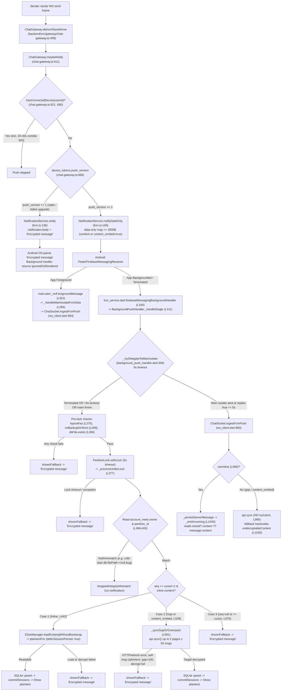

# Notification Decryption Bugfix Guide (`notifbugfix.md`)

---

## 1. Problem Summary & Current Flow Trace

### Objective
Ensure incoming **text** message notifications (both 1:1 E2EE direct messages and plaintext group chats) render the **actual decrypted message text** rather than `"Encrypted message"` whenever the Android app is **closed, terminated, or backgrounded**.

### Current End-to-End Flow Trace



---

## 2. Root Cause Analysis

Root causes are ordered from highest real-world impact/likelihood to edge cases, with **Code Bugs** explicitly separated from **Operational / Data-State Issues**.

---

### A. Operational & Data-State Root Causes

#### RC-1 [Operational / Data-State]: Pre-Existing `device_tokens` Rows Default to `push_version = 1` (or Migration `000010` Unapplied / Old Gateway Image)
- **Files & Symbols:**
  - `backend/migrations/000010_push_capabilities.up.sql:6-7`
  - `backend/src/gateway/chat-gateway.ts:598-609, 664-677` (`ChatGateway.notificationPreview`, `ChatGateway.maybeNotify`)
  - `backend/src/lib/fcm.ts:136-160` (`NotificationService.notify`)
  - `mobile/lib/core/notifications/background_push_handler.dart:215-218` (`BackgroundPushHandler._handleSingle`)
  - `Makefile:93-95` (`migrate-up` target comment still references `000001 through 000007`)
- **How It Produces `"Encrypted message"`:**
  1. Migration `000010_push_capabilities.up.sql:6-7` alters `device_tokens` with `ADD COLUMN push_version SMALLINT NOT NULL DEFAULT 1`. Every existing install in Postgres remains at `push_version = 1` until the upgraded app successfully executes `POST /api/v1/devices/fcm-token` with `push_version: 2`.
  2. In `ChatGateway.maybeNotify` (`chat-gateway.ts:666-677`), any row with `push_version < 2` is routed to `v1Fids` -> `NotificationService.notify()` (`fcm.ts:136-160`), which attaches a top-level `notification: { title, body }` block where `body` is computed by `notificationPreview()` (`chat-gateway.ts:607`: `if (isEncryptedContent(message.content)) return 'Encrypted message';`).
  3. When the app is backgrounded or terminated, Android OS renders the FCM `notification` block directly as `"Encrypted message"`, and `BackgroundPushHandler._handleSingle` (`L216`) immediately returns `BackgroundPushOutcome.ignoredOsRendered`.
  4. If the gateway container has not been rebuilt after `000010_push_capabilities` or the migration has not been applied, `v2` data-only delivery cannot occur at all.

#### RC-2 [Operational / Build Config]: Release Builds Block Cleartext HTTP in `network_security_config.xml`, Breaking Background `/sync` on Plain `http://` Hosts
- **Files & Symbols:**
  - `mobile/android/app/src/main/res/xml/network_security_config.xml:16-21`
  - `mobile/android/app/src/debug/res/xml/network_security_config.xml:13-19`
  - `mobile/lib/core/notifications/background_push_handler.dart:605-609, 748-768` (`BackgroundPushHandler._syncGapOrOversized`)
- **How It Produces `"Encrypted message"`:**
  - Release builds enforce `<base-config cleartextTrafficPermitted="false">` (`src/main/res/xml/network_security_config.xml:17`). If a release build is pointed at a plain `http://` LAN/dev API URL, every Case 2 background `api.sync()` call (for any sequence gap or >3,500 B `content_omitted: "true"` payload) fails at the Android network stack with a cleartext error, is caught at `background_push_handler.dart:748`, and falls through to `_fallbackDisplayContent(parsed)` -> `"Encrypted message"`.

---

### B. Code Bugs (Mobile, Backend, & Native)

#### RC-3 [Code Bug — Critical]: `FcmService.currentToken()` Broadcast Race & `initialize()` Permission Failure Keep Upgraded Devices Permanently Stuck on `push_version = 1`
- **Files & Symbols:**
  - `mobile/lib/core/notifications/fcm_service.dart:115-163` (`FcmService.initialize`, `FcmService.currentToken`, `FcmService.onTokenRefresh`)
  - `mobile/lib/core/notifications/push_registration.dart:53-69, 90-106` (`PushRegistration.start`, `PushRegistration.ensureRegistered`, `PushRegistration._registerCurrent`)
  - `mobile/lib/core/providers.dart:586-594, 677-684, 729` (`SessionLifecycle._start`, `SessionRuntime.build`, `bootstrapProvider`)
- **Supporting Code Evidence:**
  ```dart
  static Future<void> initialize({AppLogger? logger}) async {
    ...
    try {
      await Firebase.initializeApp();
      await FirebaseMessaging.instance.requestPermission();
      await FirebaseMessaging.instance.setForegroundNotificationPresentationOptions(...);
      _initialized = true;
    } catch (error) {
      ...
      _initialized = false;
    }
  }

  static Future<String?> currentToken() async {
    if (!_initialized) return null;
    try {
      final registered = FirebaseMessaging.instance.onRegistered.first;
      await FirebaseMessaging.instance.register();
      return await registered.timeout(const Duration(seconds: 10));
    } catch (error) { ... return null; }
  }
  ```
- **How It Produces `"Encrypted message"`:**
  1. In `firebase_messaging: 17.1.0`, `MethodChannelFirebaseMessaging.registeredStreamController` is a non-replaying **broadcast** `StreamController` fed by Android `FlutterFirebaseRegisteredLiveData`. If `onRegistered` fires during engine boot before `PushRegistration.start()` runs—or if `FirebaseMessaging.instance.register()` does not re-emit on an already-registered install (app upgrade or account switch)—`onRegistered.first` hits the 10 s timeout, `currentToken()` returns `null`, and the client **never calls `POST /api/v1/devices/fcm-token` with `push_version: 2`**. The backend row remains at `push_version = 1` and keeps sending legacy `"Encrypted message"` pushes.
  2. `FcmService.initialize()` awaits `FirebaseMessaging.instance.requestPermission()` inside the same `try/catch` as `Firebase.initializeApp()`. If `requestPermission()` throws (e.g., Activity not attached yet or concurrent permission request with `LocalNotificationService.requestPermission()` at `providers.dart:597`), `_initialized` is forced to `false`, permanently preventing `PushRegistration.start()` from registering `push_version: 2`.
  3. If a user logs in before `bootstrapProvider` finishes `FcmService.initialize()`, `SessionRuntime` triggers `SessionLifecycle._start()` -> `push.start()`, which hits `if (!_isAvailable()) return;` (`push_registration.dart:56`), never attaches `onTokenRefresh`, and never upgrades `push_version` to `2` until a later socket reconnect.

#### RC-4 [Code Bug — Critical]: Cold-Start `AppDatabase.forAccountLazy` Leaves `db.filePath == null`, Skipping `PartitionGuard.verify()` & `PartitionLock`
- **Files & Symbols:**
  - `mobile/lib/core/database/app_database.dart:135-153` (`AppDatabase.forAccountLazy`)
  - `mobile/lib/core/providers.dart:205-225, 520-572` (`appDatabaseProvider`, `SessionLifecycle._start`)
  - `mobile/lib/main.dart:42-62, 219, 285-301` (`main`, `_CpChatAppState._bootstrap`)
  - `mobile/lib/core/notifications/background_push_handler.dart:306-315, 388-400` (`_handleSingle`, `_processUnderLock`)
- **Supporting Code Evidence:**
  ```dart
  AppDatabase.forAccountLazy({ ... })
      : filePath = dirs.cachedNoBackupDir == null
            ? null
            : AccountPaths(...).dbFile.path,
  ```
  ```dart
  if (scope != null && db.filePath != null) {
    resolvedPaths = await AccountPaths.resolve(scope.accountId, _ref.read(appDirsProvider));
  }
  ```
- **How It Produces `"Encrypted message"` (or Dropped Pushes):**
  1. On cold start for an already signed-in user, `main()` hydrates `initialAuth` (`main.dart:45`) and immediately calls `runApp()` (`main.dart:51`) while `_bootstrap()` (`bootstrapProvider` -> `dirs.initialize()`) is deferred to `addPostFrameCallback` (`main.dart:219`).
  2. Frame 1 renders `ConversationsScreen`, which watches `conversationsProvider` -> `chatDaoProvider` -> `appDatabaseProvider`. At that moment `dirs.cachedNoBackupDir` is still `null`, so `AppDatabase.forAccountLazy` sets `final String? filePath = null` **permanently for the entire session**.
  3. When `SessionLifecycle._start()` subsequently runs, `db.filePath != null` at `providers.dart:521` and `providers.dart:549` evaluates to **`false`**. As a result:
     - `PartitionLock.withLock(...)` (`L562`) is completely bypassed, allowing startup `E2eeManager.bootstrap()` to race an active background isolate and desync ratchet state -> `"Encrypted message"`.
     - `PartitionGuard.verify(db)` (`L532`) is completely bypassed, so `account_meta` (`owner_user_id`, `partition_id`) and `acct.<id>.partition_id` are never repaired/written if absent, causing `BackgroundPushHandler._processUnderLock` (`L391-400`) to abort with `droppedIntegrityMismatch`.
     - If the user closes the app before any Drift query opens the lazy DB file, `paths.dbFile.exists()` at `background_push_handler.dart:306` is `false` -> `shownFallback` -> `"Encrypted message"`.

#### RC-5 [Code Bug — Critical]: `ChatSocket.ingestFcmPush` Missing `try/catch` Around `_syncConversation`, Plaintext Group Fallback Hardcoded to `undecryptableContent`, and Raw Ciphertext Fallback in `_emitIncoming`
- **Files & Symbols:**
  - `mobile/lib/core/network/ws_client.dart:965-1064` (`ChatSocket.ingestFcmPush`, `ChatSocket._emitIncoming`)
  - `mobile/lib/main.dart:247-256` (`_CpChatAppState._registerBackgroundFcmBridge`)
  - `mobile/lib/core/notifications/notification_policy.dart:55-57` (`NotificationPolicy.preview`)
- **Supporting Code Evidence:**
  ```dart
  await _syncConversation(
    conversationId,
    cursor,
    ensureConversation: hint,
    incrementUnread: isFromOther && !isActiveChat,
  );
  ```
  ```dart
  content: (msgType == 'image' || msgType == 'file')
      ? (content ?? '')
      : undecryptableContent,
  ```
  ```dart
  toEmit = msg;
  final stored = await _dao.message(message.clientMsgId);
  content: stored?.content ?? message.content,
  ```
- **How It Produces `"Encrypted message"`:**
  1. **Plaintext group chat forced to `"Encrypted message"` (`ws_client.dart:1028-1030`):** On the gap / `content_omitted` fallback path in `ingestFcmPush`, any `text` message—**including plaintext group messages** whose `content` is already present in `data['content']`—is unconditionally replaced with `undecryptableContent`, which `NotificationPolicy.preview()` renders as `"Encrypted message"`.
  2. **Uncaught `_syncConversation` exception triggers dual-isolate collision (`ws_client.dart:989-994`):** `await _syncConversation(...)` has no `try/catch`. On any transient network/API/ordering error while the app is backgrounded, `ingestFcmPush` throws before reaching the fallback block (`L1016-1033`), `main.dart:253` sends `false` to `replyPort`, and `BackgroundPushHandler` then opens SQLite and retries in the background isolate concurrently with the live main isolate—failing or desyncing into `"Encrypted message"`.
  3. **Raw ciphertext emission when `stored == null` (`ws_client.dart:984, 1049-1059`):** On `canInline`, `toEmit = msg` still carries the raw `e2ee:v1:` ciphertext. `_emitIncoming()` relies on re-reading `_dao.message(message.clientMsgId)` to recover the decrypted plaintext. If `_dao.upsertServerMessage()` skipped the write (e.g., `seq <= clearedSeq`, DB closed/scope race, or transient guard return), `stored` is `null`, so `stored?.content ?? message.content` passes raw ciphertext to `MessageNotifier.onLiveMessage()` -> `"Encrypted message"`.
  4. **Legacy v1 push hitting `_onForegroundMessage` (`main.dart:331-354`):** Any push without `push_schema == '2'` skips `ingestFcmPush()` completely and forwards `notification.body` (`"Encrypted message"`) straight to `MessageNotifier.onForegroundFcm()`.

#### RC-6 [Code Bug — Critical]: 5-Second Main-Isolate Handoff Timeout & Missing `reloadSessionsFromDisk()` Cause Dual-Isolate Ratchet Corruption (`"Encrypted message"`)
- **Files & Symbols:**
  - `mobile/lib/core/notifications/background_push_handler.dart:150, 228-230, 358-375` (`BackgroundPushHandler._tryDelegateToMainIsolate`)
  - `mobile/lib/main.dart:218, 232-278` (`_registerBackgroundFcmBridge`, `_handleMainIsolateFcmData`)
  - `mobile/lib/core/crypto/e2ee_manager.dart:226-233` (`E2eeManager.reloadSessionsFromDisk`)
  - `mobile/lib/core/providers.dart:560-570` (`SessionLifecycle._start`)
- **Supporting Code Evidence:**
  ```dart
  final ack = await reply.first.timeout(mainIsolateHandoffTimeout);
  return ack == true;
  ```
  ```dart
  try {
    await PartitionLock.withLock(resolvedPaths.partitionDir, () => verifyAndBootstrap(resolvedPaths));
  } catch (error) {
    await verifyAndBootstrap(resolvedPaths);
  }
  ```
- **How It Produces `"Encrypted message"`:**
  1. `main.dart:248-255` only sends `replyPort.send(true)` **after** `ingestFcmPush(data)` finishes completely (including awaiting `_syncBarrier` and REST `/sync` calls whose `ApiClient` timeout is up to 30 s). If that takes >5 s, `_tryDelegateToMainIsolate()` times out and returns `false`, causing `BackgroundPushHandler` to run a **second** decrypt + `/sync` + Keystore write concurrently with the live main isolate (which does NOT hold `.partition.lock` during runtime). Both isolates advance the symmetric ratchet independently, corrupting `acct.<id>.e2ee_sessions` so the next message fails AES-GCM (`SecretBoxAuthenticationError` / `chain_position_ahead`) -> `"Encrypted message"`.
  2. `SessionLifecycle._start()` (`providers.dart:566-569`) catches `PartitionLock` 6 s timeout (easily exceeded when `BackgroundPushHandler` holds `.partition.lock` across HTTP `api.sync()` calls up to 26 s!) and runs `verifyAndBootstrap()` **without the lock**.
  3. `E2eeManager.reloadSessionsFromDisk()` (`e2ee_manager.dart:226`) has **zero callers** in `mobile/lib/`. If the background isolate advances and commits `acct.<id>.e2ee_sessions` right as the app starts or while backgrounded, the main isolate keeps stale in-memory chain indices, fails to decrypt subsequent messages, and overwrites the newer sessions on disk when it next calls `_persistSessions()`.
  4. `main.dart:218` registers `kMainIsolateFcmPortName` synchronously in `initState()` before `LocalNotificationService.initialize()` completes; a handoff during startup completes `ingestFcmPush()` while `LocalNotificationService._initialized == false`, silently dropping the notification (`local_notification_service.dart:171`).

#### RC-7 [Code Bug — Critical]: Self-Sent Encrypted Messages in a Gap Permanently Abort `BackgroundPushHandler._syncGapOrOversized()` to `"Encrypted message"`
- **Files & Symbols:**
  - `mobile/lib/core/notifications/background_push_handler.dart:660-699, 795-796` (`_syncGapOrOversized`, `_isReadableContent`)
  - `mobile/lib/core/crypto/e2ee_manager.dart:347-348` (`E2eeManager._plaintextFor`)
- **Supporting Code Evidence:**
  ```dart
  final selfId = _scope?.userId ?? await _tokenStore.readUserId();
  if (senderId != null && senderId == selfId) return content;
  ```
  ```dart
  if (!_isReadableContent(plaintext)) {
    return _PartitionResult.show(
      title: title,
      displayContent: undecryptableContent,
      isGroup: false,
      outcome: BackgroundPushOutcome.shownFallback,
    );
  }
  ```
- **How It Produces `"Encrypted message"`:**
  - If the user sent an encrypted message from another device (or has an uncached own message at `seq = N`), `e2ee.plaintextFor()` returns the raw `e2ee:v1:` ciphertext at `e2ee_manager.dart:348`.
  - `_syncGapOrOversized()` tests `_isReadableContent(plaintext)`, which returns `false` for `e2ee:v1:` strings, and immediately aborts the entire sync loop at `seq = N` returning `undecryptableContent` (`"Encrypted message"`). Because `runningCursor` never advances past `N`, **every subsequent push from that peer (`seq = N+1, N+2, ...`) permanently shows `"Encrypted message"`** until the app is opened.

#### RC-8 [Code Bug — Critical]: Background `/sync` on Expired 15-Minute JWT Can Wipe `TokenStore` or Revoke Refresh-Token Family, Forcing `"Encrypted message"`
- **Files & Symbols:**
  - `mobile/lib/core/notifications/background_push_handler.dart:179-185, 594-609` (`_defaultApiClient`, `_syncGapOrOversized`)
  - `mobile/lib/core/network/api_client.dart:760-786` (`ApiClient._performRefresh`)
  - `backend/src/domain/refresh-tokens.ts:35-69` (`RefreshTokenRepository.rotate`)
  - `backend/src/config.ts:17` (`ACCESS_TOKEN_TTL_SECONDS = 900`)
- **Supporting Code Evidence:**
  ```dart
  if (response.statusCode != 200) {
    await _tokenStore.clear();
    return false;
  }
  ```
- **How It Produces `"Encrypted message"`:**
  1. Access tokens expire every 15 minutes. Any terminated-app Case 2 push (gap or >3,500 B `content_omitted: "true"`) after 15 minutes gets a `401` on `/sync` and invokes `ApiClient._performRefresh()`.
  2. Any non-200 refresh response (e.g., `429`, `400`, or a concurrent refresh race with the waking main isolate) calls `await _tokenStore.clear()`—wiping `access_token`, `refresh_token`, `user_id`, and `active_account_id` in the background! `/sync` fails -> `"Encrypted message"`, and all subsequent pushes are dropped as `droppedAccountMismatch`.
  3. `RefreshTokenRepository.rotate()` (`refresh-tokens.ts:40-66`) performs a non-transactional `SELECT` followed by `UPDATE` without `SELECT ... FOR UPDATE`; two racing isolates presenting the same refresh token trigger `revokeFamily(row.user_id)`, invalidating all sessions.

#### RC-9 [Code Bug — High]: `BackgroundPushHandler` Silent Failure on `LegacyMigration.layoutKey`, Large Gaps (>100 Messages), `Case 3` Stale/Null `seq`, and Undiagnosed E2EE Failures
- **Files & Symbols:**
  - `mobile/lib/core/notifications/background_push_handler.dart:152-153, 275-285, 442-486, 567-575, 602-609, 629-636, 763-768`
  - `mobile/lib/core/crypto/e2ee_manager.dart:437-438` (`E2eeManager._logFailure`)
- **How Each Branch Produces `"Encrypted message"`:**
  1. **`layout != LegacyMigration.layoutVersion` (`L275-285`):** If `LegacyMigration.runIfNeeded()` failed during `bootstrapProvider` (`providers.dart:716-720` swallows exceptions), `local_layout` is unset and every background push shows `"Encrypted message"` with no log.
  2. **100-message cap (`maxSyncPages = 2`, `syncPageLimit = 50`, `L152-153, 602-609`):** If a user was offline for >100 messages in a conversation, `_syncGapOrOversized` stops before reaching `parsed.seq`, leaving `targetMessage == null` -> L765 `_fallbackDisplayContent(parsed)` -> `"Encrypted message"` even though keys and network are healthy.
  3. **Case 1 missing `parsed.senderId != null` guard (`L442-456, 483`):** If `conv == null` and `senderId` is absent, `peerId` resolves to `''` -> decrypt fails -> `"Encrypted message"`.
  4. **Case 3 (`seq <= cursor` not found by `clientMsgId`, `L567-575`):** If an earlier optimistic/placeholder row exists with `seq == parsed.seq` under a different `clientMsgId` (or `local_messages` had `undecryptableContent` at `seq` from a prior failed sync), `parsed.seq <= cursor` hits Case 3 and falls back to `"Encrypted message"` without checking whether a readable row exists at `(conversationId, seq)`.
  5. **Zero diagnostic observability (`L461-466, 663-668`):** `BackgroundPushHandler` constructs `E2eeManager` with `logger: null`, so `E2eeManager._logFailure()` returns immediately at `e2ee_manager.dart:438`. All `shownFallback` paths (`L284, 298, 314, 341, 473, 526, 574, 634, 676, 697, 767`) never record a reason code to `/logs`.

#### RC-10 [Code Bug — High]: Main-Isolate `TokenStore()` Uses `resetOnError: true`, Risking Keystore Wipe of All E2EE Keys
- **Files & Symbols:**
  - `mobile/lib/core/storage/token_store.dart:18-39` (`TokenStore`, `TokenStore.forBackground`)
- **How It Produces `"Encrypted message"`:**
  - While `TokenStore.forBackground()` sets `AndroidOptions(resetOnError: false)`, the default main-isolate `TokenStore()` still uses `AndroidOptions(resetOnError: true)` (`L23`). A transient Android Keystore/Keymaster exception during cold start or screen-lock transition wipes the entire `FlutterSecureStorage` file—erasing `acct.<id>.e2ee_keys` and `acct.<id>.e2ee_sessions`. Subsequent background pushes fail `loadExistingWithoutBootstrap()` (`background_push_handler.dart:467`) and show `"Encrypted message"`.

#### RC-11 [Code Bug — Medium]: `PartitionLock._reclaimIfStale` TOCTOU Race & Zombie WebSocket Push Suppression
- **Files & Symbols:**
  - `mobile/lib/core/account/partition_lock.dart:118-145` (`PartitionLock._reclaimIfStale`)
  - `backend/src/gateway/chat-gateway.ts:41, 302-318, 621-624, 690-695` (`ChatGateway.sweep`, `maybeNotify`, `hasConnectedDevice`)
  - `backend/src/lib/fcm.ts:73-79` (`STALE_TOKEN_CODES`)
  - `mobile/android/app/proguard-rules.pro` & `mobile/packages/cpchat_storage_dirs/android/build.gradle`
- **Impact on Background/Terminated Notifications:**
  1. `_reclaimIfStale()` deletes `.partition.lock` without atomic rename, so two waiters racing on a stale lock can delete a freshly acquired lock and trigger concurrent DB/ratchet corruption -> `"Encrypted message"`.
  2. `ChatGateway.sweep()` refreshes Redis `conn:` TTLs on the first 20 s tick before observing a `pong`, leaving dead/frozen sockets marked connected for 20–40 s and skipping FCM; `hasConnectedDevice(userId)` also suppresses pushes to an offline Android phone if another device of the same user has a live socket.
  3. `STALE_TOKEN_CODES` includes `'messaging/invalid-argument'`, which can permanently prune healthy `push_version = 2` device rows on any payload formatting edge case.
  4. `CpchatStorageDirsPlugin` lacks `@Keep` and an explicit ProGuard keep rule (`-keep class com.cpchat.storage_dirs.** { *; }`) in release builds (relies solely on direct reference from `GeneratedPluginRegistrant`).

---

## 3. Implementation Plan (Step-by-Step)

### 3.1 Operational & Deployment Steps (Run First)

1. **Apply Migration `000010_push_capabilities` and Rebuild/Restart Backend Containers:**
   - Ensure `000010_push_capabilities.up.sql` is applied in PostgreSQL (`device_tokens.push_version` column exists) and both `api` and `gateway` containers are built from the latest backend source (`Makefile` targets `migrate-up` and `backend-restart`).
   - Verify no stale `device_tokens` rows remain stuck at `push_version = 1` for upgraded clients once Phase 3.3 deploys.
2. **Enforce HTTPS for Release Builds:**
   - Ensure `API_BASE_URL` and `WS_BASE_URL` passed to release builds use `https://` / `wss://` so Android's `network_security_config.xml` (`cleartextTrafficPermitted="false"`) does not block Case 2 background `/sync` requests.
3. **Fix `docker-compose.yml:245`:**
   - Move `stop_grace_period: 60s` out of `gateway.environment:` to the `gateway:` service level (4-space indentation) so graceful drains complete and unregister Redis `conn:` keys cleanly.

---

### 3.2 Backend Changes

#### Step B1 — `backend/src/lib/fcm.ts`
- **Locations:** `STALE_TOKEN_CODES` (`L73-79`), `NotificationService.sendMulticast` (`L181-224`)
- **Changes:**
  1. Remove `'messaging/invalid-argument'` from `STALE_TOKEN_CODES` so payload errors never delete healthy `push_version = 2` device tokens; log `messaging/invalid-argument` at `error` level with non-secret metadata (`mode`, `data_keys`, `data_bytes`).
  2. Chunk `fids` into batches of `500` inside `sendMulticast()` (matching `firebase-admin`'s `FCM_MAX_BATCH_SIZE = 500`) and aggregate returned stale FIDs across chunks.
  3. Log `push_version` split counts (`v2_count`, `v1_count`, `content_omitted`) at `info` level (never logging plaintext or ciphertext) so operators can immediately spot devices still stuck on `v1`.

```ts
const STALE_TOKEN_CODES = new Set([
  'messaging/installation-id-not-registered',
  'messaging/registration-token-not-registered',
  'messaging/unregistered',
  'messaging/invalid-registration-token',
]);
```

#### Step B2 — `backend/src/gateway/chat-gateway.ts`
- **Locations:** `HEARTBEAT_INTERVAL_MS` (`L41`), `onConnection` (`L232-235`), `sweep` (`L302-318`), `deliverStoredInner` (`L526-533`), `maybeNotify` (`L611-680`)
- **Changes:**
  1. Lower `HEARTBEAT_INTERVAL_MS` to `12_000` and move `this.registry.refresh(userId, deviceId)` and `this.ctx.presence.touch(userId)` into `ws.on('pong')` (instead of refreshing unconditionally in `sweep()` before a pong is received).
  2. In `maybeNotify()`, replace the user-global `hasConnectedDevice(userId)` gate with per-device filtering:
     - Collect connected `device_id`s from local open sockets (`this.sockets` for `userId`) plus `await this.registry.liveDevices(userId)`.
     - Filter `tokens` to `offlineTokens = tokens.filter((t) => !connectedDeviceIds.has(t.device_id))`.
     - If `offlineTokens.length === 0`, skip push; otherwise partition `offlineTokens` into `v2Fids` and `v1Fids`.
  3. Wrap `this.maybeNotify(...)` inside `deliverStoredInner()` (`L531`) in a `try/catch` that logs a warning so push failures never abort message fan-out.
  4. Log `{ user_id: userId, v2: v2Fids.length, v1: v1Fids.length, conversation_type: payload.conversationType, seq: message.seq }` at `info` level before dispatch.

#### Step B3 — `backend/src/domain/refresh-tokens.ts`
- **Location:** `RefreshTokenRepository.rotate` (`L35-69`)
- **Changes:**
  - Execute `rotate()` inside a PostgreSQL transaction using `SELECT id, user_id, expires_at, revoked_at, replaced_by FROM refresh_tokens WHERE token_hash = $1 FOR UPDATE`, preventing concurrent background + main isolate refresh calls from racing into `revokeFamily()`.

#### Step B4 — `backend/src/http/user-routes.ts` & `backend/src/http/auth-routes.ts`
- **Locations:** `DELETE /api/v1/devices/fcm-token` (`user-routes.ts:190-194`), `POST /api/v1/auth/logout` (`auth-routes.ts:156-160`)
- **Changes:**
  1. In `DELETE /api/v1/devices/fcm-token`, resolve `deviceId` from optional query/body `device_id`, `x-device-id` header, and `request.deviceId`, deleting all matching rows for `request.userId` (and optional `fcm_token` scoped to `request.userId`).
  2. In `POST /api/v1/auth/logout`, when revoking a refresh token that has a `device_id`, also delete `device_tokens` for `(user_id, device_id)`.

---

### 3.3 Mobile Changes

#### Step M1 — Fix `FcmService` Initialization & FID Caching (`mobile/lib/core/notifications/fcm_service.dart`)
- **Locations:** `FcmService.initialize` (`L115-138`), `FcmService.currentToken` (`L142-160`), `FcmService.onTokenRefresh` (`L162-163`)
- **Changes:**
  1. Set `_initialized = true` immediately once `await Firebase.initializeApp()` succeeds.
  2. Remove `await FirebaseMessaging.instance.requestPermission()` from `FcmService.initialize()` (permission is requested post-login via `LocalNotificationService.requestPermission()`, eliminating duplicate dialogs and preventing permission errors from disabling FCM).
  3. Wrap `setForegroundNotificationPresentationOptions(...)` in its own non-fatal `try/catch`.
  4. Subscribe permanently to `FirebaseMessaging.instance.onRegistered` inside `initialize()`, caching the latest FID in `static String? _cachedFid` and re-broadcasting through an internal broadcast `StreamController<String>`.
  5. In `currentToken()`: if `_cachedFid != null`, return `_cachedFid` immediately (optionally firing `unawaited(FirebaseMessaging.instance.register())` once per session to refresh in background); otherwise listen to `onRegistered.first`, invoke `register()`, and await with a 10 s timeout.
- **Concrete Logic:**
```dart
static bool _initialized = false;
static String? _cachedFid;
static StreamSubscription<String>? _registeredSub;
static final StreamController<String> _fidController = StreamController<String>.broadcast();
static AppLogger? _logger;

static Future<void> initialize({AppLogger? logger}) async {
  if (logger != null) _logger = logger;
  if (_initialized) return;
  try {
    await Firebase.initializeApp();
    _initialized = true;
    _registeredSub ??= FirebaseMessaging.instance.onRegistered.listen((fid) {
      if (fid.isEmpty) return;
      _cachedFid = fid;
      _fidController.add(fid);
    });
    try {
      await FirebaseMessaging.instance.setForegroundNotificationPresentationOptions(
        alert: true,
        badge: true,
        sound: true,
      );
    } catch (_) {}
    _logger?.info('fcm', 'FCM initialized');
  } catch (error) {
    _logger?.warn('fcm', 'FCM unavailable: $error', meta: {'error': error.toString()});
    _initialized = false;
  }
}

static Future<String?> currentToken() async {
  if (!_initialized) return null;
  if (_cachedFid != null && _cachedFid!.isNotEmpty) {
    unawaited(FirebaseMessaging.instance.register().catchError((_) {}));
    return _cachedFid;
  }
  try {
    final registered = _fidController.stream.first;
    await FirebaseMessaging.instance.register();
    final fid = await registered.timeout(const Duration(seconds: 10));
    _cachedFid = fid;
    return fid;
  } catch (error) {
    _logger?.warn('fcm', 'FCM registration unavailable', meta: {'error': error.toString()});
    return null;
  }
}

static Stream<String> get onTokenRefresh =>
    _initialized ? _fidController.stream : const Stream<String>.empty();
```
- **Rationale:** Guarantees every upgraded or account-switched device immediately obtains its FID and upgrades `device_tokens.push_version` from `1` to `2` (`RC-3`, `RC-1`).

#### Step M2 — Resolve `AppDirs` & `deviceId` Before `runApp()`, Fix `AppDatabase.forAccountLazy` `filePath`, and Await Bootstrap in `SessionLifecycle`
- **Files & Locations:**
  - `mobile/lib/main.dart:32-63, 285-319`
  - `mobile/lib/core/providers.dart:45, 205-225, 502-601, 698-731`
  - `mobile/lib/core/database/app_database.dart:135-158`
  - `mobile/lib/core/notifications/push_registration.dart:53-69`
- **Changes:**
  1. In `main()` (`main.dart:32-63`):
     - Initialize `final appDirs = AppDirs(); await appDirs.initialize();` and write `resolvedNoBackup` to `tokenStore` before `runApp()` (non-fatal `try/catch`).
     - Resolve/create `deviceId` from `tokenStore` before `runApp()` and pass both `appDirsProvider.overrideWithValue(appDirs)` and `deviceIdProvider.overrideWith(() => DeviceIdNotifier(initial: deviceId))` in `ProviderScope.overrides`.
     - Remove premature `await CrashReporter.initialize()` from `main.dart:39` and call it inside `bootstrapProvider` right after `await FcmService.initialize(...)`.
  2. In `AppDatabase.forAccountLazy` (`app_database.dart:135-158`):
     - Make `_filePath` mutable internally (updated inside the `LazyDatabase` opener once `AccountPaths.resolve` finishes) so `db.filePath` is never permanently `null` if constructed lazily.
  3. In `SessionLifecycle._start()` (`providers.dart:502-601`):
     - Always resolve `resolvedPaths = await AccountPaths.resolve(scope.accountId, _ref.read(appDirsProvider))` whenever `scope != null` (do **not** gate on `db.filePath != null`!).
     - Run `PartitionGuard.verify(db)` and `e2ee.bootstrap()` under `PartitionLock.withLock(resolvedPaths.partitionDir, ...)` without the unsafe unlocked fallback (`L566-569`—use a 10 s timeout after moving network `/sync` out of the lock in Step M4).
     - Ensure `await _ref.read(bootstrapProvider.future)` (bounded) has completed before calling `push.start()` so `FcmService.isAvailable` is already `true` and `onTokenRefresh` is attached (`RC-3`, `RC-4`).
  4. In `PushRegistration.ensureRegistered()` (`push_registration.dart:66-69`):
     - Also attach `_refresh ??= (_refreshStream ?? FcmService.onTokenRefresh).listen(...)` if `_refresh == null` and `_isAvailable()` is now `true`.
  5. In `providers.dart` / `main.dart` (`didChangeAppLifecycleState`):
     - When `AppLifecycleState` enters `paused` / `detached` for >4 s, cleanly disconnect `ChatSocket` so the backend stops treating the backgrounded/frozen app as socket-connected and immediately dispatches v2 FCM pushes; reconnect on `resumed` and call `e2eeManager.reloadSessionsFromDisk()` if a background write marker changed while backgrounded.

#### Step M3 — Two-Phase Main-Isolate Handoff & Fix `ChatSocket.ingestFcmPush` (`mobile/lib/main.dart`, `mobile/lib/core/network/ws_client.dart`)
- **Locations:**
  - `mobile/lib/main.dart:232-278` (`_registerBackgroundFcmBridge`, `_handleMainIsolateFcmData`)
  - `mobile/lib/core/notifications/background_push_handler.dart:150, 358-375` (`_tryDelegateToMainIsolate`)
  - `mobile/lib/core/network/ws_client.dart:883-1064` (`ingestFcmPush`, `_emitIncoming`, `_persistServerMessage`)
- **Changes:**
  1. **Two-phase handoff (`main.dart:232-278` & `background_push_handler.dart:358-375`):**
     - Queue incoming port payloads in `_CpChatAppState` until `_bootstrapComplete == true` (guaranteeing `LocalNotificationService.initialize()` has finished).
     - Reply `replyPort.send(true)` **immediately** upon accepting the payload into the main isolate queue (do not wait for network `/sync`), and reduce `mainIsolateHandoffTimeout` to `const Duration(seconds: 2)` solely to detect a dead port. This eliminates dual-isolate execution during >5 s syncs (`RC-6`).
  2. **Wrap `_syncConversation` in `try/catch` and fix plaintext group fallback (`ws_client.dart:988-1033`):**
     ```dart
     try {
       await _syncConversation(
         conversationId,
         cursor,
         ensureConversation: hint,
         incrementUnread: isFromOther && !isActiveChat,
       );
     } catch (error) {
       logger?.warn(
         'fcm',
         'main isolate fcm sync failed',
         meta: {'conversation_id': conversationId, 'seq': seq, 'error': error.runtimeType.toString()},
       );
     }
     if (_scopeClosed) return;
     ```
     And in the fallback block (`ws_client.dart:1020-1033`), preserve plaintext for group/unencrypted messages instead of hardcoding `undecryptableContent`:
     ```dart
     final isGroupPush = (conversationType ?? existingConv?.type) == 'group';
     final fallbackContent = (msgType == 'image' || msgType == 'file')
         ? (content ?? '')
         : (content != null && content.isNotEmpty && !isEncryptedContent(content))
             ? content
             : (isGroupPush ? '' : undecryptableContent);
     ```
  3. **Return decrypted content directly from `_persistServerMessage` (`ws_client.dart:965-986, 1045-1064, 1071-1131`):**
     - On `canInline`, pass the decrypted `stored` message (not raw ciphertext `msg`) into `toEmit`, and in `_emitIncoming` still prefer `stored?.content ?? message.content` so raw ciphertext can never leak to `MessageNotifier` if a subsequent DB read misses (`RC-5`).
  4. **Prevent duplicate banner when live WS delivers a message already persisted by `BackgroundPushHandler` (`ws_client.dart:825-870`):**
     - Record `final wasAlreadyReadable = await _alreadyReadable(message);` before `_persistServerMessage`; only emit `_emitIncoming` when `!wasAlreadyReadable`.

#### Step M4 — Harden `BackgroundPushHandler`, `ApiClient`, `TokenStore`, & `PartitionLock`
- **Files & Locations:**
  - `mobile/lib/core/notifications/background_push_handler.dart:151-153, 179-185, 275-356, 377-770`
  - `mobile/lib/core/network/api_client.dart:18-43, 760-786`
  - `mobile/lib/core/storage/token_store.dart:18-24`
  - `mobile/lib/core/account/partition_lock.dart:118-145`
- **Changes:**
  1. **Never wipe tokens in background isolate (`api_client.dart:18-43, 760-786`):**
     - Add `final bool clearTokensOnRefreshFailure;` (default `true`) to `ApiClient`; pass `clearTokensOnRefreshFailure: false` in `BackgroundPushHandler._defaultApiClient()`.
     - In `_performRefresh()`, only clear tokens when `clearTokensOnRefreshFailure` is `true` AND the server returned `401` with `invalid_token` (never on `429`, `400`, `422`, or transport errors).
     - Serialize `_performRefresh()` across isolates using a short-TTL lock file in `noBackupRoot` (re-reading the access token inside the lock so if the other isolate just rotated it, the second isolate skips `/auth/refresh` and reuses the new token) (`RC-8`).
  2. **Do not hold `.partition.lock` across HTTP `/sync` (`background_push_handler.dart:320-342, 548-769`):**
     - Acquire `.partition.lock` briefly to read partition integrity, `conv`, and `cursor`, and run Case 1 inline decryption directly under the lock (<100 ms).
     - For Case 2 (gap / `content_omitted`), release the lock before calling `api.sync()`, fetch the missing pages (raise `syncPageLimit` to `200`, `maxSyncPages` to `3`, bounded by a 12 s wall-clock budget), then re-acquire `.partition.lock` briefly to verify cursor continuity, decrypt in ascending `seq` order, commit SQLite first, and call `commitSessions()` (`RC-6`, `RC-9`).
  3. **Handle self-sent encrypted messages inside `_syncGapOrOversized()` (`background_push_handler.dart:660-730`):**
     ```dart
     if (!isGroup && msg.type == 'text' && isEncryptedContent(msg.content)) {
       if (msg.senderId == userId) {
         await dao.upsertServerMessage(
           Message(
             id: msg.id,
             conversationId: msg.conversationId,
             seq: msg.seq,
             senderId: msg.senderId,
             clientMsgId: msg.clientMsgId,
             type: msg.type,
             content: undecryptableContent,
             createdAt: msg.createdAt,
           ),
           status: 'sent',
           ensureConversation: hint,
           incrementUnread: false,
         );
         runningCursor = msg.seq;
         continue;
       }
       ...
     }
     ```
     This keeps `runningCursor` advancing across self-sent messages from other devices so subsequent peer messages decrypt cleanly (`RC-7`).
  4. **Guard Case 1 `parsed.senderId != null` (`L442-446`) & Case 3 readable-by-seq lookup (`L567-575`):**
     - Require `parsed.senderId != null` for Case 1 encrypted decryption (otherwise route to Case 2 `/sync`).
     - In Case 3 (`parsed.seq != null && parsed.seq! <= cursor`), query `local_messages` by `(conversationId, seq)` before falling back; if a readable row already exists, suppress as `suppressedDuplicate` instead of painting `"Encrypted message"`.
  5. **Allow `layoutKey` self-check when partition DB & meta are valid (`L275-285`):**
     - If `layout != LegacyMigration.layoutVersion`, do not immediately short-circuit to `"Encrypted message"` if `noBackupDirStrict` + `paths.dbFile.exists()` + read-only `account_meta` (`owner_user_id` & `partition_id`) all match `activeAccountId` (`RC-9`).
  6. **Disable destructive `resetOnError: true` on main-isolate `TokenStore()` (`token_store.dart:22-24`):**
     - Change default `AndroidOptions(resetOnError: false)` so transient Android Keystore errors never wipe all accounts' E2EE keys (`RC-10`).
  7. **Fix `PartitionLock._reclaimIfStale()` TOCTOU (`partition_lock.dart:118-145`):**
     - Atomically `rename()` the stale lock file to `${lockFile.path}.reclaim.${_uuid.v4()}` before deleting it so a competing waiter can never delete a freshly acquired lock (`RC-11`).
  8. **Add Safe, Metadata-Only Diagnostic Logging for Every Fallback Path (`background_push_handler.dart`):**
     - Define an enum `BackgroundFallbackReason` (`layoutUnmigrated`, `noBackupDirUnavailable`, `dbMissing`, `lockTimeout`, `noLocalKeys`, `decryptFailed`, `syncFailed`, `syncGapTooLarge`, `syncDiscontinuous`, `staleSeq`).
     - Pass a lightweight background `AppLogger` (or record non-secret entries `{ ts, outcome, fallback_reason, decrypt_reason, conversation_id, seq, push_schema, content_omitted }`—**never** plaintext, ciphertext, or keys) into `E2eeManager` and append bounded JSONL entries (max 50 lines) to `<partitionDir>/bg_push_diag.jsonl`, drained and forwarded to `/api/v1/logs/client` on next foreground startup so any future `"Encrypted message"` occurrence is immediately diagnosable.

---

### 3.4 Android Native & ProGuard Changes

#### Step A1 — `mobile/packages/cpchat_storage_dirs/android/src/main/java/com/cpchat/storage_dirs/CpchatStorageDirsPlugin.java` & `mobile/android/app/proguard-rules.pro`
- **Changes:**
  1. Annotate `CpchatStorageDirsPlugin` with `@androidx.annotation.Keep`.
  2. Add explicit keep rule in `mobile/android/app/proguard-rules.pro`:
     ```proguard
     -keep class com.cpchat.storage_dirs.** { *; }
     ```
- **Rationale:** Guarantees R8 minification in release builds never strips or renames `CpchatStorageDirsPlugin`, keeping `AppDirs.noBackupDirStrict()` functional in the headless background isolate (`RC-11`).

#### Step A2 — Channel Parity (`mobile/android/app/src/main/kotlin/com/cpchat/mobile/MainActivity.kt` & `mobile/lib/core/notifications/local_notification_service.dart`)
- **Locations:** `MainActivity.kt:20-34`, `local_notification_service.dart:131-139`
- **Changes:**
  - Align `LocalNotificationService.initialize()` channel creation with `MainActivity.kt` (`importance: Importance.high`, `playSound: true`, `enableVibration: true`, `enableLights: true`, `description: 'Incoming chat messages'`) so channels created cold in the background isolate match channels created by `MainActivity`.

---

## 4. Security Invariants & Edge Cases

Every modification above preserves all core security and reliability invariants:

1. **Strict End-to-End Encryption (Zero Server Plaintext Exposure):**
   - The backend (`chat-gateway.ts`, `fcm.ts`) never receives, decrypts, or logs 1:1 plaintext. `v2` data-only FCM pushes carry only the existing `e2ee:v1:` ciphertext envelope (or `content_omitted: "true"` when exceeding `MAX_FCM_DATA_BYTES = 3500`), and decryption occurs exclusively on-device using Android Keystore-backed keys (`acct.<accountId>.e2ee_keys` / `acct.<accountId>.e2ee_sessions`).
   - All diagnostic logging added to `BackgroundPushHandler` and `fcm.ts` records strictly non-secret metadata (`fallback_reason`, `decrypt_reason`, `seq`, `conversation_id`, `v2`/`v1` counts, byte length)—never plaintext, ciphertext, or cryptographic keys.
2. **Crash-Safe Write Ordering (SQLite Before Ratchet Persistence):**
   - Both inline (`Case 1`) and gap-synced (`Case 2`) background decryptions continue to call `plaintextFor(..., deferSessionPersist: true, allowBootstrap: false)`, commit the decrypted message row to Drift SQLite **first**, and call `e2ee.commitSessions()` **second** under `.partition.lock`.
   - If the OS kills the process between the two writes, the decrypted row is already safely persisted in SQLite (`_alreadyReadable()` skips re-decryption on next app open) and the symmetric ratchet cleanly skips forward to `i + 1` on the next incoming envelope.
   - Moving network `api.sync()` outside `.partition.lock` never weakens write ordering: cursor verification, decryption, SQLite commit, and `commitSessions()` all still execute atomically inside the lock.
3. **Multi-Account Isolation:**
   - Every background and foreground push continues to pass `shouldHandleFcmForAccount(recipientUserId, activeAccountId, hasSession)` and read-only `account_meta` (`owner_user_id` + `partition_id`) verification against `AccountStore(tokenStore, activeAccountId)` before touching any DB or key material.
   - Fixing `AppDatabase.forAccountLazy` `filePath` and cold-start `PartitionGuard.verify()` strengthens isolation by ensuring `account_meta` markers are always populated and checked on cold-start sessions.
   - Hardening `DELETE /api/v1/devices/fcm-token` and `/auth/logout` prevents signed-out accounts from continuing to receive pushes on a shared device.
4. **Non-Text Messages (`image` & `file`) and Group Chats:**
   - Media messages (`type == 'image' | 'file'`) never enter the symmetric ratchet and continue to format via `NotificationPolicy.preview()` (`"Photo: <caption>"` / `"Sent an image"`, `"File: <caption>"` / `"Sent a file"`).
   - Group text messages are plaintext by design (`docs/e2ee.md`); fixing `ingestFcmPush` (`RC-5`) ensures a transient `/sync` error on a group push never mislabels a plaintext group message as `"Encrypted message"`.
5. **Legitimate Undecryptable Fallbacks Preserved:**
   - When decryption genuinely cannot succeed—such as after a key reset/rotation on another device (`session_key_mismatch`), before the user unlocks a Direct Boot locked Keystore (`no_local_keys`), or on a genuinely offline gap whose preceding encrypted message is unavailable—the handler leaves SQLite and ratchet state untouched and renders the safe `"Encrypted message"` placeholder without leaking raw `e2ee:v1:` envelopes.
